# Run to Run Wx

**[runtorunwx.com](https://runtorunwx.com)** maps **GFS, ECMWF (IFS), GEM, ICON, AIFS and AIGFS
forecasts and the GEFS, ECMWF ENS, AIGEFS and HGEFS ensemble means, how each has changed between model runs,
and how the models differ**. It started as a 250 mb
wind-speed version of the Tropical Tidbits "trend" overlays (as the GFS Trend Viewer). It now has
eight fields, each with **Forecast**, **Trend** and **Compare** modes, across each model's full
forecast range (GFS, AIGFS and the GEFS and AIGEFS means 16 days, ECMWF, AIFS and the ECMWF ENS
mean 15 days, GEM and the HGEFS mean 10 days, ICON 7.5 days), for North America or a focused region.

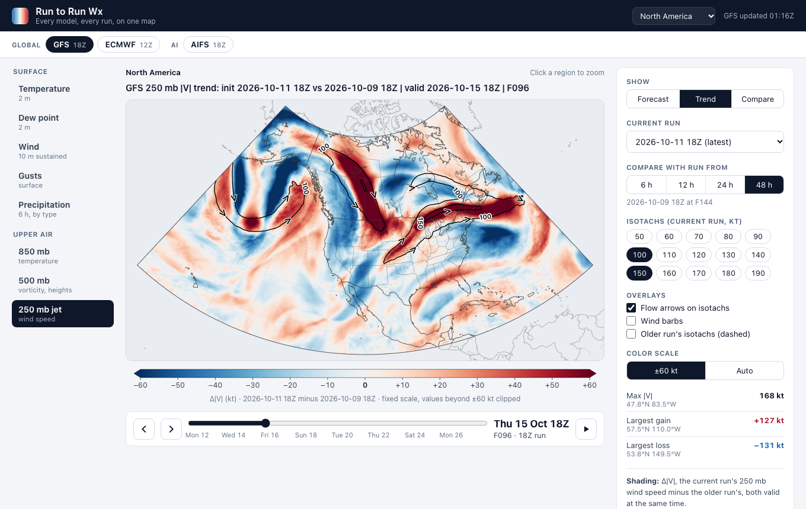

| Temperature | Wind | Precipitation |
|---|---|---|
| 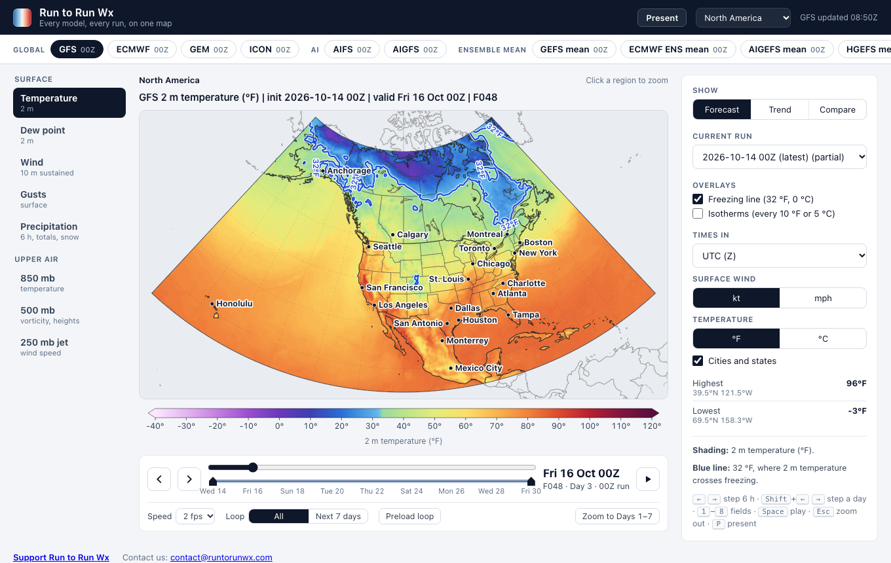 | 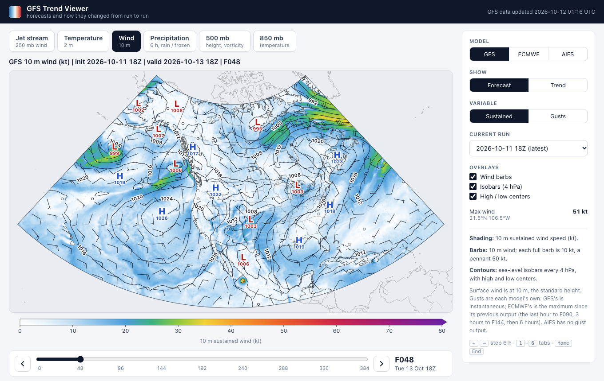 | 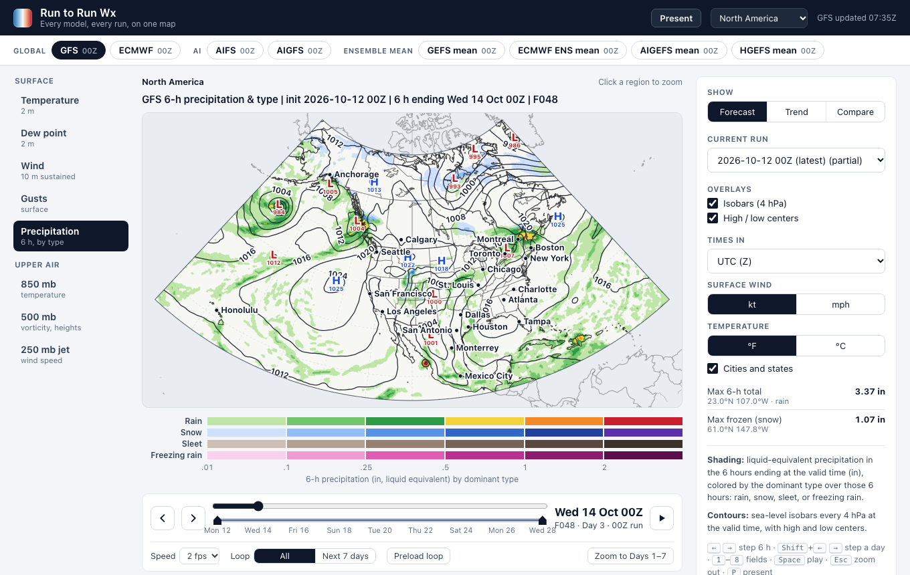 |

| 500 mb, GFS | 500 mb, ECMWF | 500 mb, AIFS | 850 mb | Phone |
|---|---|---|---|---|
| 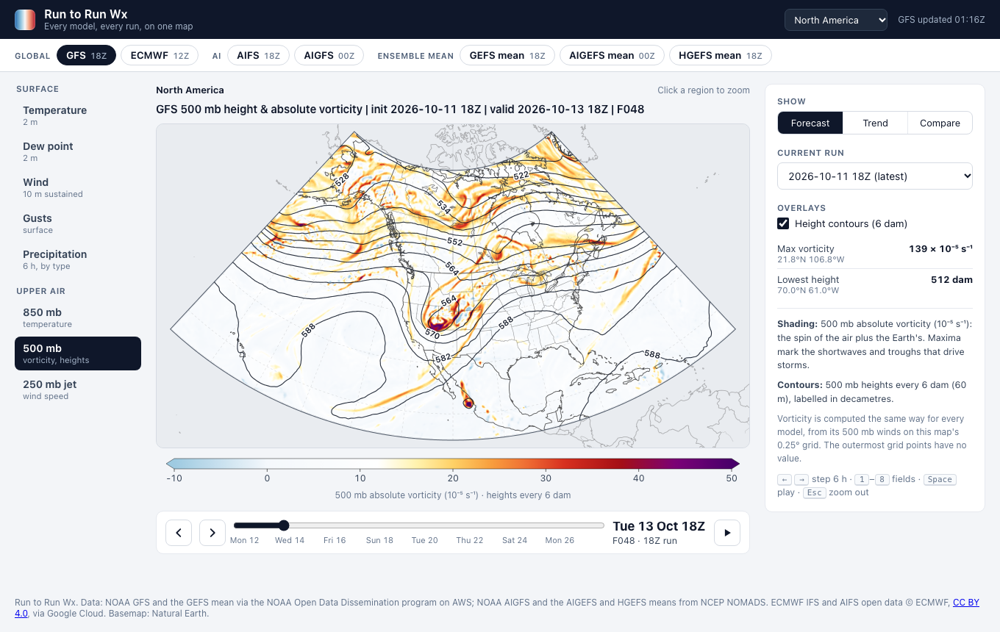 | 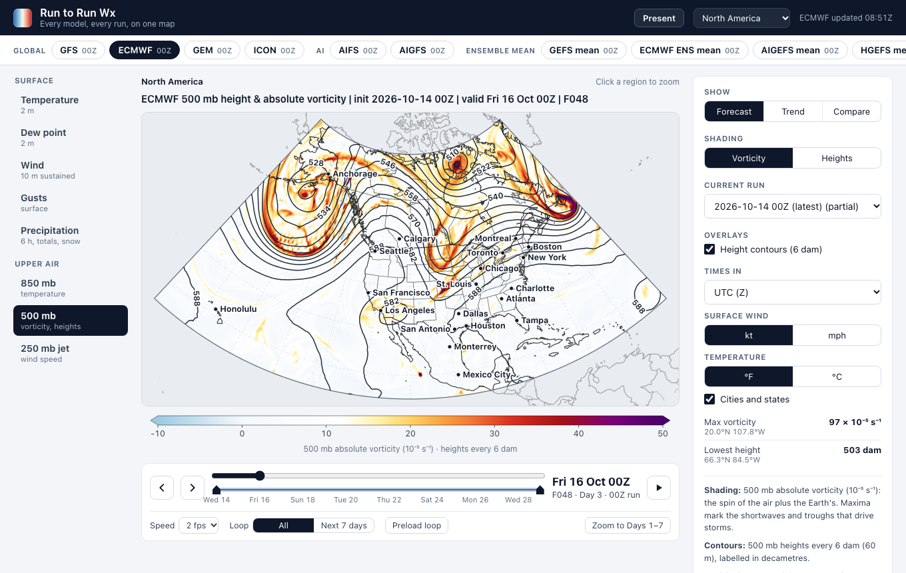 | 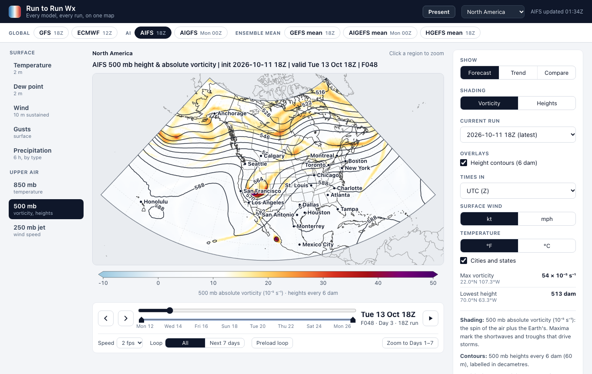 | 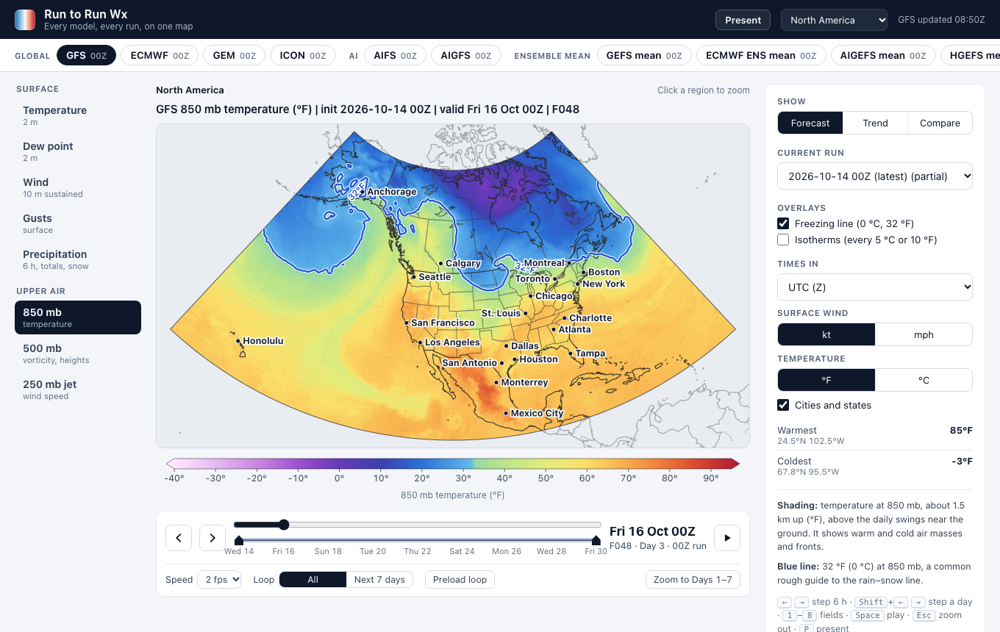 | 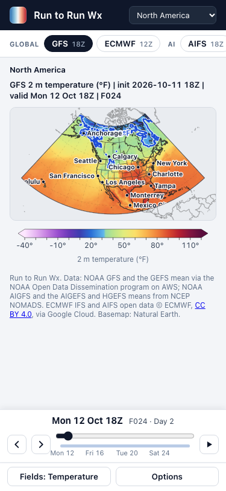 |

| 500 mb, GEM | 500 mb, ICON |
|---|---|
| 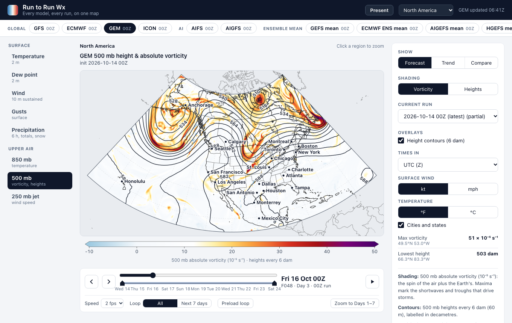 | 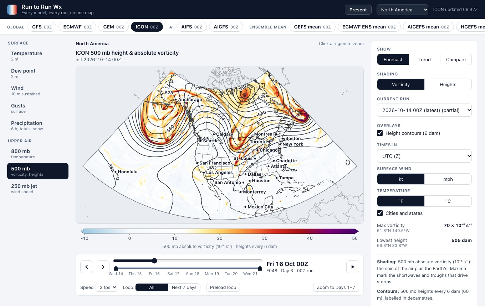 |

| Field | Forecast | Trend (current − older run, same valid time) | Overlays |
|---|---|---|---|
| **Jet stream** (250 mb) | wind speed (kt) | Δ\|V\|: red faster, blue slower | isotachs 50–190 kt with flow arrows, wind barbs, the older run's isotachs (dashed violet) |
| **Temperature**, **Dew point** (2 m) | °F or °C | Δ: red warmer, blue colder | freezing line, isotherms (10 °F or 5 °C), the older run's freezing line |
| **Wind** (10 m sustained), **Gusts** | kt or mph | Δ: red windier, blue calmer | wind barbs (always kt), isobars every 4 hPa, H/L centers |
| **Precipitation** | 6-hour total by dominant type: rain, snow, sleet, freezing rain (one neutral scale for models with no type output: AIGFS, AIGEFS, HGEFS). **Snow**: snowfall in inches at 10:1, from each model's own snow amount (GFS, ECMWF, GEM, ICON, AIFS and the GEFS and ECMWF ENS means). Either as a **24-h** or **Total** amount, summed over a window every map on screen shares | Δ amount over the same hours: green wetter (snowier), brown drier | isobars, H/L centers |
| **500 mb** | absolute vorticity (10⁻⁵ s⁻¹), or heights | Δ height (dam): red higher, blue lower | heights every 6 dam, the older run's heights |
| **850 mb** | temperature (°F or °C) | Δ: red warmer, blue colder | freezing line, isotherms (5 °C or 10 °F), the older run's freezing line |

The page has a **model bar** across the top (grouped Global · AI · Ensemble mean), a **Fields** sidebar on the
left, the options on the right, and a **valid-time scrubber** under the map:

- **Models:** switching keeps the field and the valid time. The bar shows only models that output
  the selected field, each with its latest run ("18Z"), and says who's missing ("Not shown: AIFS
  (no gust output)"). Picking a field the current model lacks switches to another model with a
  banner ("AIFS doesn't output gusts, so this shows GFS.").
- **Regions and states:** hover a US region to outline it, click to zoom (or use the region menu);
  inside a region, click a state to zoom to it (a small state shows at least 6° × 4.5° around it).
  The breadcrumb or <kbd>Esc</kbd> zooms back out a level. Zooming refits the map, centered on the
  region: no frames are fetched again. Stats cover the region in view.
- **Map labels:** the largest US TV markets (plus a few in Canada, Mexico, Alaska and Hawaii) at
  every zoom, smaller cities and state abbreviations in a region or state, placed so they never
  overlap. "Cities and states" in Options turns them off (remembered).
- **Compare:** this model and another side by side at the same valid time, or their difference
  (A − B) when both are on the same grid.
- **Time:** the scrubber spans the model shown (and the compared one), so it ends where the data
  does (HGEFS at 10 days). Switching model or run keeps the valid time; the shown run's coverage is
  shaded, and a time it doesn't reach says where it starts or ends. Times read in the viewer's zone with Z
  beside them ("Wed 14 Oct 8 PM ET · Thu 00Z") and a day count (Day 1 is today). Options picks the
  zone (ET, CT, MT, PT, AKT, HT or UTC; the first visit takes the browser's when it's one of
  these) and the units (kt or mph, °F or °C), remembered in the browser.
- **Loops:** 1–8 frames a second, a range set with the handles under the scrubber (or "Next 7
  days"), a 1.5 s hold on the last frame, and "Preload loop" to fetch every frame first. "Zoom to
  Days 1–7" narrows the scrubber. <kbd>←</kbd> <kbd>→</kbd> step 6 h, with <kbd>Shift</kbd> a day.
- **Phones:** the model bar scrolls, Fields and Options are bottom sheets, and the scrubber is
  pinned to the bottom. Tap a region to zoom.
- **Presentation mode** (<kbd>P</kbd> or **Present**, desktop): pick a layout (16:9 one map, two
  side by side or four; 9:16 one map or two stacked), go full screen, and fill each slot with a
  model, field, mode (forecast, trend, or the difference from another model), run, region or
  state, and the view's options (overlays, isotachs, color scale, the other model's run). Every
  slot shows the same valid time, and the scrubber spans the slots' models. The frame is drawn on one canvas with a header
  (field, valid time local and Z, Day N), a corner label per slot with everything about its
  forecast, one color bar when every slot shows the same forecast field (trend and difference slots
  keep their own, as their captions name the runs), the `runtorunwx.com` mark
  and the data credit, so a capture keeps them all. Map labels and lines are 1.3× larger so they
  read in a 480p downscale. Controls and Edit buttons hide 2 s after the mouse stops, and clicks on
  the map do nothing. Keys: <kbd>←</kbd>/<kbd>→</kbd> step (Shift: a day), a clicker's
  <kbd>PageDown</kbd>/<kbd>PageUp</kbd> step a day, <kbd>Space</kbd> plays, <kbd>1</kbd>–<kbd>4</kbd>
  edit a slot, <kbd>F</kbd> full screen, <kbd>G</kbd> the Shorts guide (9:16), <kbd>Esc</kbd> leaves.
  The bar has the loop's range and speed (shared with the site's), Preload, PNG and MP4.
  **PNG** saves the frame at exactly 1920 × 1080 or 1080 × 1920 (or 2× for 4K); **MP4** saves the
  loop as H.264 at a constant 30 fps (each map held for its share of a second at the loop's speed),
  rendered offscreen, so it's faster than real time and never stutters. Both are made in the
  visitor's browser, and an MP4 export stops on a second press. The layout is in the URL
  (`?present=quad&t=…&s1=…`, each slot in the site's link form without a time or pinned run, so
  it opens on the newest runs) and remembered for "Resume last layout"; a new layout starts from
  the site's view.

In trend mode the shading is, for example,

> Δ|V| = |V|(current run) − |V|(older run), both valid at the same time

and the same rule applies to every field. The jet opens in trend mode; the others open in
forecast mode. Surface wind is at 10 m, the standard height. Gusts are each model's own: GFS's and
GEM's are instantaneous, ECMWF's is the maximum over the last 1, 3 or 6 hours (by forecast range),
and ICON's the maximum over the last hour.

The site is published at **https://runtorunwx.com** (Cloudflare Workers static assets on a custom
domain; see [below](#cloudflare-and-actions-setup)). Its data lives in a Cloudflare R2 bucket served at
`https://data.runtorunwx.com`, which the pipeline updates directly, so data updates never
redeploy the site.

## How the comparison lines up

For a current run initialized at **T0** and viewed at forecast hour **f**, the valid time is
**T0 + f**. With lag **L**, the comparison frame is the run initialized at **T0 − L**, at forecast hour
**f + L**, which is valid at the same instant. For example, at the default 48 h lag:

| Current run | Hour | Valid | Compared with | Hour |
|---|---|---|---|---|
| 2026-10-08 18Z | F000 | 2026-10-08 18Z | 2026-10-06 18Z | F048 |
| 2026-10-08 18Z | F360 | 2026-10-23 18Z | 2026-10-06 18Z | F408 |

Each model is shown across its full range, so in that second row the older run has no F408 (GFS
stops at F384). Runs are fetched to `min(display max + max lag, model max)`, which is the model's
last hour. If the older run or the needed hour isn't available, the map shows a
**"comparison unavailable"** state naming exactly what is missing. It never falls back to another
lag. Precipitation is a 6-hour total, so it starts at F006, and F000 says so (so do ECMWF's and
ICON's gusts, maxima over the time before). ECMWF runs only at 00/12Z, so it has no 6-hour lag.

## Repository layout

```
config/                every parameter, shared by the pipeline and the frontend (see Configuration)
pipeline/              Python pipeline (uv): Herbie / ECMWF index / NOMADS / MSC and DWD files + cfgrib → compact frames + manifest.json
  src/wxtrend/         alignment, fields, catalog (per-model GRIB recipes), cycles, fetch (source
                       adapters), regrid (other spacings, ICON's cells), net (backoff, pacing), store,
                       manifest, update, cli
  schema/              JSON Schema for manifest.json
  tests/               pytest
web/                   static frontend (Vite + TypeScript + d3)
  src/views/           one module per view: what to load, how to shade, overlays, stats,
                       readout; index.ts lists the Fields sidebar
  src/                 map rendering, contours, barbs, pressure centers, palettes, frame loading
  scripts/             one-off Natural Earth → TopoJSON basemap builder (lines and region hit areas)
  tests/               vitest unit tests
  e2e/                 Playwright tests against the production build and real data
scheduler/             Cloudflare Worker that starts each product's workflow when its next cycle is due
shared/test-vectors/   alignment, Δ, and frame-encoding cases checked by BOTH pytest and vitest
docs/                  screenshots, adding-a-field.md (how to add the next data type)
infra/                 r2-cors.json: the R2 bucket's CORS rules
.github/workflows/     one caller per product (gfs.yml, ecmwf.yml, gdps.yml, icon.yml, aifs.yml, aigfs.yml,
                       gefs.yml, ecmwf-ens.yml, aigefs.yml, hgefs.yml) → product.yml (dispatch or cron → pipeline → R2),
                       scheduler.yml (deploys the Worker), freshness.yml (daily watchdog),
                       pages.yml (deploy on code changes), ci.yml (tests on push/PR)
data/                  pipeline output, one directory per product, e.g. data/gfs/ (git-ignored)
```

Adding another field (CAPE, …) or model is a short recipe:
**[docs/adding-a-field.md](docs/adding-a-field.md)**, which also collects the GRIB, ECMWF, storage,
and rendering gotchas. The roadmap and design decisions live in a private planning repository.

## Local setup

Prerequisites (all free): [uv](https://docs.astral.sh/uv/) (`brew install uv`) and Node.js 22+.
uv installs a suitable Python (3.11+) on its own, and the `eccodes` wheel bundles the ecCodes
library, so nothing else needs to be installed.

```bash
make setup
```

```bash
make dev
```

`make dev` processes each product's latest complete cycle plus the older runs needed for the
longest lag (9 runs for the 6-hourly products, 5 for ECMWF; 61 to 65 hours each, 41 for HGEFS),
then serves the site at http://localhost:5173. Later runs only fetch what's new. The NOMADS
products (AIGFS, AIGEFS, HGEFS) are paced to 60 requests a minute, so each first backfill takes
20–40 minutes. `make dev QUICK=1` fetches just the runs the newest one is compared against (5,
or 4 for ECMWF). The ECMWF ENS mean averages 50 members, about 300 MB of downloads an hour (some
90 GB for its window), so `make dev` and `make data` leave it out unless `PRODUCTS` names it
(`make data PRODUCTS=ecmwf-ens`); the e2e bundle has two of its runs. GEM and ICON have no index, so
their files are downloaded whole: about 20 MB an hour for GEM (4 GB for its window) and 50 MB for
ICON, whose source keeps only its latest 00Z and 12Z runs, so a first backfill has two. If the fetch
fails (for example when offline) but data already exists, the site is served anyway.

Other targets:

| Command | What it does |
|---|---|
| `make data` | Run the pipeline once for every product (`wxtrend update --product …`) into `data/<product>/` |
| `make test` | pytest + vitest |
| `make e2e` | Build, serve, and run the Playwright tests against `data/`, which needs every product (also writes the screenshots) |
| `make e2e-data` | Build the small dataset CI runs the e2e on (each product's pinned cycle and lag runs, F000–F060) into `e2e-data/`; the products whose source doesn't keep the pinned cycle (NOMADS, GEM, ICON) and the ECMWF ENS mean come from the frozen bundle pinned in the `Makefile`. Test with `WXTREND_DATA_DIR=$PWD/e2e-data make e2e` |
| `make e2e-fixtures` | Rebuild that frozen bundle (`e2e-fixtures.tar.gz`), for a new release when a bundled product's fields change: it fetches the products named in `E2E_FIXTURES_FETCH` from their sources and copies the rest from the pinned bundle. A source that no longer has the pinned cycle (ICON's after a day, AIGEFS's and HGEFS's after two) can't be fetched again, so changing one of their fields means moving the whole e2e to a new cycle (see `docs/adding-a-field.md`) |
| `make build` | Build the static site into `web/dist/` (production reads data from R2) |
| `make verify` | Validate each product's `manifest.json` against the schema and decode every frame of every run file |
| `make r2-cors R2_BUCKET=<name>` | Apply `infra/r2-cors.json` to the bucket with wrangler (run `npx wrangler@4 login` first) |

### Pipeline CLI

```bash
cd pipeline
uv run wxtrend update                        # latest complete cycle + retention window; no-op if done
uv run wxtrend update --cycle 2026100818     # treat a specific cycle as latest
uv run wxtrend --data-dir /tmp/dry fetch --cycle latest --hours 0       # one-hour dry run into /tmp/dry/gfs/
uv run wxtrend --data-dir /tmp/dry fetch --product ecmwf --cycle latest --hours 0,96,150   # ECMWF dry run
uv run wxtrend fetch --cycle latest --hours 0-24 --fields t2m,mslp      # selected fields
uv run wxtrend verify                        # schema + every run file's frames
uv run wxtrend inspect --fhr 120 --lag 48 --field t2m --band temp       # Δ statistics for one pair
uv run wxtrend update --remote               # what CI runs: R2's manifest decides what's missing
uv run wxtrend verify --remote               # run files not on disk must be named by R2's manifest
uv run wxtrend sync                          # publish to R2: new run files, then the manifest, then prune
uv run wxtrend archive                       # copy what the private archive keeps but lacks from the public bucket
uv run wxtrend storage                       # both buckets' sizes; fails over the budgets in config/site.json
uv run wxtrend repack                        # pack a local store's loose frames into run files (no fetching)
```

Every command takes `--product` (`gfs`, the default, `ecmwf`, `gdps`, `icon`, `aifs`, `aigfs`, `gefs`,
`ecmwf-ens`, `aigefs` or `hgefs`), e.g.
`uv run wxtrend update --product ecmwf`. Each product is stored in `<data-dir>/<product>/` (e.g.
`data/gfs/`), the same layout as the bucket. The R2 commands read `R2_ACCOUNT_ID`,
`R2_ACCESS_KEY_ID`, `R2_SECRET_ACCESS_KEY` and `R2_BUCKET` from the environment; `archive` and
`storage` read `R2_ACCOUNT_ID`, `R2_BUCKET`, `ARCHIVE_ACCESS_KEY_ID`, `ARCHIVE_SECRET_ACCESS_KEY`
and `ARCHIVE_BUCKET`.

**The archive:** a private bucket (no public URL) keeps runs after they leave the public one. A
product's `archive` setting (`products.<id>` in `config/models/`) says what it keeps: `"full"`,
every frame, where the source keeps runs less than a year (AIGFS, AIGEFS and HGEFS from NOMADS, GEM
from MSC's 30 days, ICON from DWD's one day), copied as the public run files are; or `"f000"`, the
analysis hour only (the default), every field's F000 read by byte range and written as one run
file. Each archived run has a `runs/<run>/run.json`: the public manifest's product, model, grid and
encoding, the hours archived and the run file holding each field's, and their fields' specs, so a
run stays readable after an encoding change. It's written after the run's files, and the next pass
works out what's missing from it. Nothing in the archive is deleted, and no key is written twice,
so a bucket lock can refuse every overwrite and delete: when a run gains hours, its manifest gets a
new version (`run.2.json`, `run.3.json`, ...) and **the highest version is the run's manifest**
(`archive.read_run`). A run file already there isn't written again. Runs archived before run files
(2026-10-13 to the switch) keep the old layout, a file per frame, and a run.json without `files`.

**Latest complete cycle:** `update` steps back from the current cycle (6-hourly; 12-hourly for
ECMWF). It sends HEAD requests for the index file of every forecast hour it needs (the model's
`index_url`), checking the last hour first. The first cycle with all of them published is used.
NOMADS products read the cycle's directory listing once instead, and need both of an hour's
files (`sfc` and `pres`). GEM and ICON have no index: every file an hour's fields read must be
listed, one listing per directory (an hour's for GEM, a variable's for ICON).

**Fetching:** for each (run, hour) with any missing field, only the needed GRIB messages are
downloaded, with HTTP range requests from the index: through Herbie for GFS (`.idx`, about 9 MB
per hour), and directly from ECMWF's eccodes `.index` for IFS and AIFS (Google Cloud mirror; about
14 and 8 MB per hour, including the f−6 running totals that 6-hour precipitation needs). The
NOMADS products read each file's `.idx`, then every needed message in one multi-range request,
paced under NOMADS's per-IP limit. GEM and ICON publish one file per variable and hour, which
are downloaded whole (ICON's bz2-compressed), and each file's message is checked against the WMO
parameter, level, time window (an instant, a 6-hour bucket, a total since T0 or the last hour's
maximum) and run it should hold. GEFS's 0.5°, GEM's 0.15° and ICON's icosahedral cells are regridded to
the 0.25° display grid (barycentric weights, cached in `.cache/regrid/`, with ICON's cell
coordinates); the others are cropped. Each field is then
computed, encoded, and gzipped in a pool of worker processes, with retries; HTTP requests back
off on throttling.

**Pruning and the manifest:** runs outside the window are deleted, and the manifest is rebuilt from
what is on disk (plus, with `--remote`, what R2's manifest lists). When a field is added to a
model's file in `config/models/`, the next update fetches just that field for every retained run.

## Cloudflare and Actions setup

Do these once:

1. **Cloudflare Workers Paid** on the account that holds the buckets: the site and the scheduler
   are Workers there.
2. **Settings → Actions → General:** make sure Actions are allowed. The workflows declare their own
   permissions, so the default read-only token setting is fine.
3. **Cloudflare R2:** a bucket, an API token with object read/write on that bucket only, and the
   repository secrets `R2_ACCOUNT_ID`, `R2_ACCESS_KEY_ID`, `R2_SECRET_ACCESS_KEY` and `R2_BUCKET`.
   Apply the CORS rules with `make r2-cors R2_BUCKET=<name>` (or paste the same origins into the
   bucket's **Settings → CORS policy**).
   The archive is a second bucket, `runtorunwx-archive`, with no custom domain and its `r2.dev`
   URL off, and an API token with object read on the public bucket and object read/write on the
   archive only, as the secrets `ARCHIVE_ACCESS_KEY_ID` and `ARCHIVE_SECRET_ACCESS_KEY`. The
   archive has a bucket lock rule with no prefix and **Indefinite** retention (**Settings →
   Bucket lock rules**), so nothing in it can be overwritten or deleted.
4. **Domains:** `runtorunwx.com`'s DNS is on Cloudflare. The bucket's custom domain is
   `data.runtorunwx.com`. `runtorunwx.com` and `www.runtorunwx.com` are the site Worker's custom
   domains (`routes` in `web/wrangler.toml`), which Cloudflare creates, with their DNS records and
   certificates, on the first deploy; neither host may have another DNS record then. A redirect
   rule (**Rules → Redirect Rules**) sends `www.runtorunwx.com/*` to `https://runtorunwx.com/${1}`
   with a 301, keeping the query string.
5. **Actions → GFS / ECMWF / GEM / ICON / AIFS / AIGFS / GEFS mean / ECMWF ENS mean / AIGEFS mean /
   HGEFS mean → Run workflow** for the first data. With an empty bucket each
   backfills its whole window. The schedules then take over.
6. **Actions → Deploy site → Run workflow** for the first deploy, once the scheduler's
   `CLOUDFLARE_API_TOKEN` (step 7) exists. Later deploys happen on their own
   when code changes.
7. **The scheduler** (a Cloudflare Worker acting as a GitHub App):
   - Create a GitHub App (**Settings → Developer settings → GitHub Apps → New**) with the webhook
     off and repository permissions **Actions: read and write** and **Issues: read and write**.
     Note its App ID, generate a private key, and install it on this repository only.
   - In Cloudflare, create an API token from the **Edit Cloudflare Workers** template, and open
     **Workers & Pages** once: that creates the account's `workers.dev` subdomain, without which
     Cloudflare won't set the Worker's cron (the Worker itself gets no public URL).
   - Add the repository secrets `CLOUDFLARE_API_TOKEN`, `SCHEDULER_APP_ID` and `SCHEDULER_APP_KEY`
     (the downloaded `.pem`, pasted whole). The account id is `R2_ACCOUNT_ID`.
   - **Actions → Scheduler → Run workflow** deploys it. Later deploys happen when `scheduler/` or
     the model configs change.

What the workflows do:

- **The scheduler Worker** (`scheduler/`, deployed by **`scheduler.yml`**) is what starts the
  product workflows. Every 10 minutes it reads each product's manifest and, once the next cycle is
  `latency_minutes` past its init (the measured posting time, in `config/models/<id>.json`),
  dispatches `<product>.yml`, unless a run of it is active or started in the last 30 minutes. A
  product still behind 3 hours after its cycle was due gets a `stale-data` issue, which the Worker
  closes once the product catches up. It authenticates as a GitHub App; its log is in the
  Cloudflare dashboard (**Workers → runtorunwx-scheduler → Logs**).

- **`gfs.yml`, `ecmwf.yml`, `gdps.yml`, `icon.yml`, `aifs.yml`, `aigfs.yml`, `gefs.yml`, `ecmwf-ens.yml`,
  `aigefs.yml`, `hgefs.yml`**
  (one small caller per product) set the schedule and
  `concurrency: product-<id>`, and run the reusable **`product.yml`**:
  1. `wxtrend update --product <id> --remote` reads the product's manifest from R2, fetches only the
     frames it doesn't list, packs each run's new frames into run files (one per run and field;
     a run whose hours fill in later is read back from R2 and written again), and writes a new
     manifest naming R2's run files plus the new ones. A bucket still in the old layout (a file per
     frame) is converted by its first pass: every frame is read back once and packed.
  2. `wxtrend verify --remote` validates the manifest: every run file it names is on disk (decoded
     and checked) or already in R2.
  3. `wxtrend sync` uploads the new run files, then the manifest, then deletes runs the manifest no
     longer lists, with every object under them. A failure stops before the next step, so R2's
     manifest only ever names files that are there. A file a rewritten run no longer uses stays
     until the run leaves the window, so a visitor holding the older manifest can still read it.
  4. `wxtrend archive` puts into the private archive, from the public bucket, the frames it should
     keep but doesn't. It runs even when nothing changed, so any later job retries a failed copy
     while the run is still public, and it comes after the sync, so a failure (which fails the job,
     and GitHub emails) never holds up the site.

  Nothing is cached between runs and nothing is deployed: R2's manifest is the source of truth. When
  nothing changed, verify and sync are skipped.
- **Schedules** are a backup to the Worker. They come from measured posting times (object
  timestamps or directory listings; each workflow's comment says when): each fires 15 minutes after
  the last needed hour usually lands, with a retry 45 minutes later.

  | Product | Complete after T0 | Runs at | Retry |
  |---|---|---|---|
  | GFS 00/06/12/18Z, F000–F384 | 5:12–5:31 | T0 + 5:47 | T0 + 6:32 |
  | ECMWF 00/12Z, F000–F360 | 7:34–7:36 (all at once) | T0 + 7:52 | T0 + 8:37 |
  | AIFS 00/06/12/18Z, F000–F360 | 5:23–5:39 | T0 + 5:55 | T0 + 6:40 |
  | GEM 00/12Z, F000–F240 | 4:47–5:34 | T0 + 5:49 | T0 + 6:34 |
  | ICON 00/12Z, F000–F180 | 3:22–3:26 | T0 + 3:41 | T0 + 4:26, and T0 + 9:41 |

  ICON has a third run because DWD replaces each run a day later: a run missed for a day is lost.

  The retry is a cheap no-op when the first run already succeeded. GitHub drops scheduled runs and
  starts others hours late (on 2026-10-12, 4 of 12 fired, 1–9 h late), which is why the Worker
  exists; a late run still takes the latest complete cycle and fills in whatever the window is
  missing, so lateness costs freshness, never data.
- **`freshness.yml`** runs daily and fails when any product is more than 12 hours past due, which
  gets GitHub to send an email. It covers the Worker itself stopping.
- **`storage.yml`** runs daily and fails when the public bucket or the archive is over its budget
  (`pipeline.storage_budget_gb` in `config/site.json`), which also sends an email. The archive's
  budget is raised by hand as it grows; nothing is deleted.
- **`pages.yml`** deploys the site when `web/`, `config/` or `shared/` change. It first builds a small
  real dataset (for each product a pinned cycle and its lag runs, F000–F060, from the sources,
  never R2; the products whose sources keep days or weeks (NOMADS, GEM, ICON) and the ECMWF ENS
  mean from a frozen bundle on a GitHub release) and runs the Playwright tests on it, then builds the production site, which reads its data from
  `VITE_DATA_BASE` in `web/.env.production` (`https://data.runtorunwx.com/`), and deploys it with
  `wrangler deploy` (`web/wrangler.toml`). Hashed files under `/assets/` are cached for a year
  (`web/public/_headers`); pages are revalidated on every visit.
- **`ci.yml`** runs pytest, vitest, a production build and the scheduler's tests on pushes to
  `main` and on pull requests.

Things to know:

- **Caching:** run files are uploaded with `Cache-Control: public, max-age=31536000, immutable` and
  the manifest with `max-age=60`. A run file is named by a digest of its bytes and never changes,
  and Cloudflare's edge caches it whole and serves byte ranges from the cache. **An encoding change
  needs a new field id**; never overwrite run files in place.
- **Writes:** one object per run and field, not per frame, keeps R2's writes (Class A operations,
  1 million free a month) at about 22,000 a month for all ten products and their archive copies,
  where a file per frame took about 890,000.
- **Byte ranges across origins:** the site (`runtorunwx.com`) reads frames from `data.runtorunwx.com`
  with a `Range` header. Chrome sends a simple range without a CORS preflight; `infra/r2-cors.json`
  also allows the header, for browsers that ask first. A server that answers with the whole file
  gets that file sliced in the browser. A ranged request that fails while the same file then loads
  whole (a refused preflight looks like any network error) reads that file whole; after two such
  files the page reads whole files from then on. A plain network error fails just that frame.
- GitHub **disables scheduled workflows in public repositories after 60 days without repository
  activity**. The Worker's dispatches don't depend on the schedules, but the backup crons and the
  watchdog do: re-enable them from the Actions tab (or push any commit).
- To refetch a product, delete `<product>/manifest.json` from the bucket. The next run treats it
  as empty.

## Data format (manifest schema 4, run files, frame format v3)

Each product's data lives in its own directory: `gfs/manifest.json` and `gfs/runs/…` in the R2
bucket, and `data/gfs/` locally (served at `/data/gfs/` by the dev server). The site finds it at
`VITE_DATA_BASE` + `<product>/`.

### Run files: `runs/<YYYYMMDDHH>/<field>.<digest>.bin`

- **One file per run and field**, holding every hour of it (manifest schema 4, since 2026-10-15;
  schema 3 had a file per hour, `runs/<run>/<field>/f<FFF>.bin.gz`). `<digest>` is the first 16 hex
  digits of the file's SHA-256, so a file never changes once written.
- **Container (`wxrb1`):** the 4 bytes `WXRB`; `n`, a little-endian uint32; `n` bytes of JSON,
  `{"v": 1, "fields": {"t2m": [[fhr, offset, length], …]}}`; then each frame's gzip bytes at its
  offset (from the start of the file), in hour order. The index of any product's file fits in the
  first 4,096 bytes, so the site reads those once, then each frame by byte range. The archive's F000
  files hold every field of a run in the same container.

### Frames

- **Fields:** a field is a group of **bands**, stored back to back in config order. Most fields
  have one band; precipitation has two (amount and type).
- **Band layout:** each band is `ny × nx` samples, row-major. **Row 0 is the northern edge (70°N)**
  and rows go south; columns go west (170°W) to east (50°W). `uint16` samples are little-endian.
- **Row-delta filter:** each row stores its first sample, then the difference from the previous
  sample modulo 2^bits. Decoding is a running sum per row. This makes gzip about 20% smaller.
- **Values:** `value = stored × scale + offset`, in the band's `units`. Values are rounded to the
  nearest step and clipped to the dtype's range. Wrapped bands (directions, `wrap: 360`) are stored
  modulo instead.
- **Missing data (v3):** a band may declare `"nodata"`, which must be the dtype's top value (255 or
  65535). Missing samples (NaN) are stored as that value, valid values are clipped to one below it,
  and decoders return NaN for it. A band without `nodata` can't hold missing data: the pipeline
  refuses to encode NaNs into it. Only `vort500` declares it (its edge rows and columns have no
  centred difference); the original nine fields are byte-for-byte the same as in v2. Adding
  `nodata` to an existing band would be an encoding change, which needs a new field id.
- **Compression:** each frame is gzipped on its own. The browser decompresses with
  `DecompressionStream('gzip')`.

| Field | Bands | Encoding |
|---|---|---|
| `wspd250` | speed | uint8, 1 kt |
| `wdir250` | dir (from) | uint8, 360/256°, wraps |
| `t2m` | temp | uint8, 1 °F, offset −80 |
| `d2m` | dewpt | uint8, 1 °F, offset −80 |
| `wspd10` | speed | uint8, 1 kt |
| `wdir10` | dir (from) | uint8, 360/256°, wraps |
| `gust` | gust | uint8, 1 kt |
| `mslp` | mslp (GFS MSLET; ECMWF and AIFS `msl`; GEM, ICON and the NOAA AI and GEFS products PRMSL) | uint16, 0.1 hPa |
| `precip` | qpf (6-h total, liquid equivalent); ptype (0 none, 1 rain, 2 snow, 3 sleet, 4 freezing rain) | uint16, 0.01 in; uint8 category |
| `snow` | sf (6-h snowfall, liquid equivalent; the site shows it at 10:1) | uint16, 0.001 in |
| `hgt500` | hgt (500 mb geopotential height) | uint16, 1 m |
| `vort500` | vort (500 mb absolute vorticity) | uint8, 10⁻⁵ s⁻¹, offset −50, nodata 255 |
| `t850` | temp (850 mb) | uint8, 0.5 °C, offset −60 |

Precipitation type is the dominant type over the same 6 hours as the total, with ties going to the
more impactful type. GFS's comes from its 6-hour-averaged categorical fields. ECMWF's is snow when
snowfall is at least half the total, else rain, overridden by freezing rain or sleet where its
instantaneous type at f or f−3 says so. AIFS and ICON have only rain and snow. GEM's is the largest
of its four 6-hour amounts (rain, snow, ice pellets, freezing rain). ECMWF, AIFS and ICON totals are
the difference of running totals (f minus f−6); GFS's and GEM's are 6-hour buckets. Vorticity is computed from each model's 500 mb winds on
the display grid, the same way for every model.

Snowfall is each model's own: ECMWF's, AIFS's and the ECMWF ENS members' `sf` and ICON's grid-scale
plus convective snow (6-hour differences of running totals), and GEM's 6-hour snow amount. GFS has no snowfall field, so its snowfall is its 6-hour average snow flag (`CSNOW`)
times its 6-hour precipitation, labelled as derived. The GEFS mean's is the mean of its 30 perturbed
members' own flag × precipitation (the same 30 members `geavg` averages), not the product of the means.
AIGFS, AIGEFS and HGEFS output no snow or type, so they don't offer it. 24-hour and Total amounts are
summed in the browser from the 6-hour frames, over a window that starts at the newest run on screen.

### `manifest.json`

The manifest is validated against `pipeline/schema/manifest.schema.json` and built from the frames
that exist (on disk, plus those already in R2), so it never lists a frame that doesn't exist. Each
run names the run file holding each of its fields (`files`). Runs are listed newest first.

```json
{
  "schema_version": 4,
  "generated_at": "2026-10-09T05:35:00Z",
  "product": "gfs",
  "model": { "id": "gfs", "name": "GFS" },
  "grid": { "id": "na025", "nx": 481, "ny": 221, "lon0": -170.0, "lat0": 70.0, "dlon": 0.25, "dlat": -0.25,
            "row_order": "north_to_south", "col_order": "west_to_east",
            "lat_min": 15.0, "lat_max": 70.0, "lon_min": -170.0, "lon_max": -50.0 },
  "compression": "gzip",
  "layout": "bands_concatenated_row_major_little_endian",
  "filter": "row_delta",
  "fields": {
    "t2m": { "label": "2 m temperature", "min_fhr": 0, "frame_bytes": 106301,
             "bands": [{ "name": "temp", "units": "F", "dtype": "uint8", "scale": 1.0, "offset": -80.0 }] },
    "precip": { "label": "6-hour precipitation and type", "min_fhr": 6, "frame_bytes": 318903, "bands": ["…"] }
  },
  "file_template": "runs/{run}/{file}",
  "container": "wxrb1",
  "cycle_interval_hours": 6,
  "display_hours": [0, 6, "…", 384],
  "latest": "2026100900",
  "runs": [
    { "id": "2026100900", "init": "2026-10-09T00:00:00Z",
      "hours": { "wspd250": [0, 6, "…", 384], "precip": [6, 12, "…", 384], "…": [] },
      "files": { "wspd250": "wspd250.3f9a0c41d27b8e65.bin", "precip": "precip.8c2e…", "…": "…" }, "complete": true }
  ]
}
```

`product` is a model on one display grid. `grid.id` names a grid in `config/grids.json`. `fields`
lists only the fields the model provides, and bands that declare `nodata` carry it here.
`complete` is `false` when some (field, hour) failed to fetch; those are retried on the next run.

Reading a frame in Python:

```python
import gzip, json, struct, numpy as np
m = json.load(open("data/gfs/manifest.json"))
g, f, run = m["grid"], m["fields"]["t2m"], m["runs"][0]
data = open(f"data/gfs/runs/{run['id']}/{run['files']['t2m']}", "rb").read()
n = struct.unpack("<I", data[4:8])[0]                       # after b"WXRB"
index = {fhr: (off, length) for fhr, off, length in json.loads(data[8:8 + n])["fields"]["t2m"]}
off, length = index[120]
raw = gzip.decompress(data[off:off + length])
d = np.frombuffer(raw, np.uint8, count=g["nx"] * g["ny"]).reshape(g["ny"], g["nx"])
stored = np.cumsum(d.astype(np.int64), axis=1) % 256       # undo the row-delta filter
temp_f = stored * f["bands"][0]["scale"] + f["bands"][0]["offset"]   # row 0 = 70°N
```

## Configuration

All parameters live in `config/`. The pipeline reads it (`wxtrend --config <dir>` or
`$WXTREND_CONFIG` to use another copy), and Vite bundles `site.json`, `grids.json`, `regions.json`
and the model files into the frontend.

| File | Key | Default | Notes |
|---|---|---|---|
| `site.json` | `views.jet.isotachs_kt` | 50–190 every 10, default [100] | |
| | `views.<id>.trend_limit` / `auto_round` | jet ±60 kt, temperature ±20 °F, wind ±20 kt, precipitation ±0.5 in (24 h ±1, Total ±2), snowfall ±4 in (24 h ±8, Total ±12), 500 mb ±60 m, 850 mb ±8 °C | Fixed trend scale; auto rounds max\|Δ\| up. Precipitation's totals and snowfall have their own keys (`precip:24h`, `snow:total`, …) |
| | `model_bar` | Global: gfs, ecmwf, gdps, icon · AI: aifs, aigfs · Ensemble mean: gefs, ecmwf-ens, aigefs, hgefs | Model-bar groups and their products, in order; the first product is the default and the last-resort fallback |
| | `projection` | Lambert conformal, central meridian 110°W, parallels 30°/60° | A focused region is centered on its own middle meridian instead |
| | `pipeline` | lookback 8 cycles, 6 worker processes, 3 attempts | |
| `fields.json` | `<id>` | see the table above | The canonical catalog: label, bands and encodings, the same for every model |
| `grids.json` | `na025` | 15–70°N, 170–50°W at 0.25° | Display grids. A cropped product's source must have its points on it; others are regridded |
| `regions.json` | `regions` | North America (`na025`), Mainland US, 8 US regions, Hawaii | Zoom boxes, `parent` (breadcrumb and <kbd>Esc</kbd>), `states` merged into click targets by `npm run basemap`; `"hit": "box"` makes the whole box the target (Hawaii's islands are too small). `npm run basemap` also writes each state's box and label point to `web/src/assets/states.json`: the 48 states (not DC or Hawaii) become zoom targets under their region |
| `cities.json` | `cities` | 42 tier-1 and 66 tier-2 cities | Map labels: tier 1 at every zoom, tier 2 in views narrower than 25° of longitude |
| `models/<id>.json` | `credit` | NOAA; ECMWF (CC BY 4.0; modified); Environment and Climate Change Canada; Deutscher Wetterdienst (CC BY 4.0; modified) | Who presentation frames and exports credit. No ", " inside one: exports break the credit line there |
| | `name`, `source` | GFS: Herbie, `pgrb2.0p25` on AWS. ECMWF/AIFS: `ecmwf_opendata` on Google Cloud, 4 connections. GEM: `msc_files`; ICON: `dwd_icon`, 24 connections | `source.index_url` templates one hour's index. The ECMWF ENS mean adds `mean_index_urls` (the files with ECMWF's own mean, by last step) and `members` (50), on 96 connections (16 for each of 6 workers). GEM and ICON have `file_url` and `variables` (each GRIB variable's file) instead, and ICON `grid_files` (its cells' coordinates) |
| | `about` | ECMWF ENS mean only | What the model's fields are made of, shown under the view's explanation |
| | `forecast_hours` | GFS 0–384, ECMWF/AIFS 0–360, GEM 0–240, ICON 0–180, every 6 h | Displayed hours; `model_max` caps the fetch range |
| | `cycle_interval_hours` | GFS/AIFS 6, ECMWF/GEM/ICON 12 | |
| | `lags_hours` / `default_lag_hours` | GFS/AIFS 6, 12, 24, 48; ECMWF/GEM/ICON 12, 24, 48 / 48 | Retention = 1 + max lag / interval runs (9, or 5 for the 12-hourly models) |
| | `fields.<id>` | all thirteen (AIFS: no gust) | The catalog fields this model provides: for Herbie a `search` regex (with `{f}`/`{a}` for buckets); `min_fhr` |
| | `products.<id>` | `gfs`, `ecmwf`, `gdps`, `icon`, `aifs`, … on `na025`; `"regrid": true` for GEFS, GEM and ICON | A product is the model on one display grid; its id names the manifest |
| | `products.<id>.archive` | `f000`; `full` for AIGFS, AIGEFS, HGEFS, GEM, ICON | What the private archive keeps of each run: every frame, or the analysis hour |

## Rendering notes

- **Projection:** d3-geo Lambert conformal conic, fit to the domain, or to a focused region's box
  and centered on its middle meridian (so the East Coast isn't tilted). Each canvas pixel is
  inverse-projected once per canvas size into a cached lookup (grid cell and bilinear weights). After
  that, a new frame only costs bilinear sampling and a color lookup table.
- **Shading:** continuous fields are sampled bilinearly. A pixel with a nodata corner (vorticity's
  outermost grid points) is transparent. Precipitation type is a category, so it is never
  interpolated: each pixel takes the nearest grid point's type (or the wettest neighbour's at the
  edge of a precipitation area).
- **Contours** (isotachs, the freezing and 0 °C lines, isobars, 500 mb heights): d3-contour runs
  on the native grid, and the contour vertices are projected. Contours use a lightly smoothed copy
  of the field (one 1-2-1 pass; three for isobars) to remove quantization staircases. Shading, readouts and stats use raw values.
- **Flow arrows and barbs:** both use the stored wind direction and the local direction of north on
  the conic projection (`screenBearing`), which tilts away from the central meridian. Barbs follow
  the Northern Hemisphere convention: pennant 50 kt, barb 10 kt, half barb 5 kt. The jet view draws
  barbs only at 40 kt and above.
- **Pressure centers:** strict local extrema of heavily smoothed sea-level pressure within a 4° window, with at
  least 3 hPa of prominence, away from the domain edge. Only the strongest of each kind nearby is
  kept.
- **Basemap:** Natural Earth 50m coastlines, borders, states/provinces and large lakes, plus US
  state polygons, both on their own (state click targets) and merged into region click targets, as
  a bundled 124 KB TopoJSON. Lines outside the data domain are faded.
- **Labels:** cities and state abbreviations are placed greedily (big cities, then states, then
  smaller cities), each name right of its dot or else left, skipping any that would overlap.
- **Regions:** focusing a region refits the projection to its box and rebuilds the pixel lookup; the
  canvas keeps its size and the decoded frames are redrawn as they are, so nothing is fetched or
  decoded again. Barb spacing and label density are in screen pixels, so they adapt to the zoom.
  The region under the pointer comes from a planar point-in-polygon test on lon/lat.
- **Frame loading:** each field loads only what it needs. A trend loads only the shaded field
  for the older run. The two hours either side are preloaded, for both maps in compare mode.
- **Models:** every product's manifest is loaded at startup, so the model bar can show only the
  models that output the field. Switching keeps the field and the valid time: the new model's
  latest run at the matching hour, clamped (with a banner) when its range doesn't reach. Lags and
  the scrubber's range follow the product. A product whose manifest can't be loaded is left out
  of the bar ("data couldn't be loaded").
- **Compare:** the other model shows its newest run that reaches the valid time by default; "Its
  run" picks the same cycle or any retained run (`crun`), and a banner flags runs that started
  more than 12 h apart. The difference map reuses each view's trend scene, with the other model in
  the "older" slot and the readouts and captions naming the models.
- **URL:** the full view is in the URL (`?m=&r=&v=&mode=&var=&run=&lag=&t=&iso=&ov=&lim=&c=&cv=&crun=`;
  `t` is the valid time, YYYYMMDDHH). Only a past run is pinned (`run`), so a link to the latest
  follows whatever is newest when it's opened. A pinned link offers the latest one if a newer run
  has arrived. Old links still open: without `m` on GFS, without `v` on the jet trend, and a
  forecast hour `f` (before `t`) from the link's run; the URL is then rewritten with `t`. A bare
  URL opens the visitor's last view, or the 500 mb forecast over Mainland US the first time.
- **Model chips** show each latest run's hour, with its day when it isn't today's (UTC), and turn
  amber when the next run is 90 minutes past its measured posting time (`latency_minutes`).
- **Keyboard:** <kbd>←</kbd>/<kbd>→</kbd> step 6 h, <kbd>1</kbd>–<kbd>8</kbd> pick a field,
  <kbd>Space</kbd> plays, <kbd>Home</kbd>/<kbd>End</kbd> jump to the first and last hour,
  <kbd>Esc</kbd> zooms out a level (or closes a sheet), <kbd>P</kbd> opens presentation mode.
- **Presentation frames** are laid out in a fixed 1920 × 1080 (or 1080 × 1920) space and drawn at
  the screen's real pixels. Each slot is a site view (`sources.ts` picks its runs and fields, as
  for the site's maps; `slot.ts` loads it at the shared valid time) drawn by an offscreen map whose
  layout size is the slot's ÷ 1.3, so lines, labels and spacing come out 1.3× larger. `compose.ts`
  lays out the silhouettes and draws the header, corner labels, color bars (canvas versions of the
  site's) and credit. The 9:16 header and color bar stay clear of where Shorts draws its own
  buttons and captions (measured on m.youtube.com; <kbd>G</kbd> shades it). MP4 export loads
  `mp4.ts` and [Mediabunny](https://mediabunny.dev/) only when used; the button shows only where
  WebCodecs can encode H.264 at the frame size.

## Tests

- **pytest** (`pipeline/tests`):
  - valid-time alignment for every lag, including year, month and leap-day boundaries
  - Δ sign convention
  - unit conversions (kt, °F, hPa, in) and wind direction
  - band encoding: rounding, clipping, scale/offset, wrapped directions, nodata, NaN refusal
  - precipitation-type classification (GFS and GEFS fractions, ECMWF snow share and type
    overrides, "unspecified" for models without type), and dew point from T and RH (Magnus,
    hand-computed)
  - absolute vorticity (solid-body rotation, a meridional-wind case, a hand-computed grid, nodata
    edges), accumulation differences and water units
  - per-hour search strings (6-hour buckets; nothing before F006) and which messages each recipe
    reads at each hour (ECMWF's f−6 totals, f−3 type, `10fg`/`10fg3`)
  - every source adapter end to end on synthetic GRIB (ECMWF index parsing and byte ranges, Herbie
    with levels merged by cfgrib, GEFS through the regridder, NOMADS's two files per hour and
    multi-range responses, GEM's whole files on a south-to-north grid, ICON's bz2 files on scattered
    cells with their coordinates read once per grid, and a file holding the wrong variable), backoff
    on `503 SlowDown`, request pacing, and not retrying a 404
  - regridding against analytic fields, from a regular grid and from scattered points: exact for
    linear ones, inside each triangle's interpolation error bound for a smooth one, nearest
    neighbour for categories, nodata outside the source, and the weights cache
  - GRIB-attribute matching
  - domain cropping and row order
  - row-delta frames, and run files: the container's index and offsets, digest names, and reading
    each field's frames back
  - the split config, products, and the manifest schema
  - cycle detection (HEADs, or directory listings for NOMADS, GEM and ICON), keeping the listed
    latest run when a check fails once, never pruning a run newer than the latest, retention, retry,
    fetching only missing fields, clearing the old layout, no-op behavior, and manifests that
    drifted from the config; packing staged frames into run files, writing again only the fields a
    pass changed, and converting a store in the old layout (a file per frame) without fetching
  - the R2 sync, against an in-memory S3 client (no test can reach the real bucket): the remote
    manifest deciding what to fetch, upload order (run files, manifest, prune), cache headers,
    refusing to publish a manifest that names a missing file, converting a bucket in the old layout
    on its next pass (leaving out, for the next pass to fetch, a frame its manifest lists but R2
    lacks), rewriting a run that fills in later from its file in R2, and a second `update --remote`
    on a store whose sync didn't happen
  - the archive: whole run files copied, each run's F000 frames read by byte range into one file,
    runs topped up when they fill in, an encoding change refused for every field a rewrite covers,
    and runs archived in the old layout kept until they gain hours (keeping any field the public
    bucket has since dropped)
- **vitest** (`web/tests`):
  - the shared alignment and Δ vectors
  - decoding the shared Python-encoded frame fixture, and reading the shared run file's index and
    frames
  - the frame cache reading a run file's index once, then frames by byte range, a header longer than
    the first bytes read, whole files when a server ignores ranges or a browser refuses them (but
    not after one network blip), urgent frames starting a preload's shared download, every frame
    waiting on a dropped download forgotten at once, and the old layout
  - palettes and tick steps, and the precipitation-type palette's color distances (CIELAB ΔE,
    with deuteranopia simulated)
  - late-run chips: the run's day, and when the next run counts as late
  - barb geometry and local north
  - pressure centers (including plateaus and double maxima)
  - precipitation shading without interpolating type
  - every view in every mode and variable, built from synthetic fields, and the Fields sidebar list
  - URL state, including old links (no `m`, no `v`, Phase 1's `f`), unpinned latest runs, the
    compared model's run (`crun`), and the remembered last view
  - regions: the config, one hit area per state, point-in-region lookups, region-limited stats;
    state zoom targets, their minimum box, point-in-state lookups, and the region-centered projection
  - map labels: tiers by zoom, no overlaps, sizes that scale
  - presentation frames: every silhouette's layout inside its frame, a shared or per-slot color bar,
    the 9:16 header and color bar clear of Shorts' overlays, the credit line, and layout links
- **Playwright** (`web/e2e`), against the production build and real pipeline output (in CI, the
  small dataset from `make e2e-data`):
  - zero console errors or failed requests
  - non-blank shading in every field and mode
  - the header format, and which frames are loaded and preloaded
  - every view for ECMWF, GEM, ICON, AIFS, AIGFS and the four ensemble means, and each one's
    precipitation legend (by type, or "type isn't available"); GEM's and ICON's own snowfall and gust
    notes; switching models keeps the field and valid time;
    picking gusts on AIFS hides its chip and falls back to GFS with a banner, and dew point on
    AIGFS or HGEFS falls back within its group
  - old links rewritten with a valid time
  - clicking a region and zooming out with <kbd>Esc</kbd>, with no frame requests or re-render
  - compare mode, side by side and as a difference; picking the other model's run (same cycle, a
    missing cycle, a day-old run with its age banner)
  - a bare URL opening 500 mb over Mainland US, then the visitor's last view
  - late-run chips under a fixed clock; ensemble means opening 500 mb on heights, and a picked
    shading sticking across models
  - the unavailable states, the hover readout, pinned links, field switching, and the older-run
    overlay
  - a 375 px phone: no overflow, bottom sheets, the pinned scrubber, tap-to-focus (screenshot)
  - state zoom inside a region and back out; the cities-and-states toggle, remembered
  - presentation mode: picking a layout, editing one slot's region, a clicker's day step, PNGs at
    exactly 1920 × 1080, 3840 × 2160 and 1080 × 1920, a `?present=` link, the Shorts guide, and an
    H.264 MP4
  - writes the screenshots in `docs/`, with the clock set just after the data's newest run so the
    chips read as fresh
- **scheduler** (`scheduler/tests`, vitest): when each product's next cycle is due, when to
  dispatch (behind, not running, not started in the last 30 minutes), opening and closing stale-data
  issues, a whole tick against a fake GitHub and fake manifests, the installation-token cache, and
  the App key's PKCS#1 → PKCS#8 wrapping and JWT (checked against Node's crypto)

## Credits

Model data: NOAA Global Forecast System and the GEFS ensemble mean via the NOAA Open Data
Dissemination program on AWS, and NOAA AIGFS and the AIGEFS and HGEFS ensemble means from NCEP
NOMADS (public domain). The ECMWF IFS, AIFS and ENS mean maps are based on data and products of the
European Centre for Medium-Range Weather Forecasts ([ECMWF](https://www.ecmwf.int/)), via the
Google Cloud mirror, published under [CC BY 4.0](https://creativecommons.org/licenses/by/4.0/).
That data is modified: cropped to North America and re-encoded, with wind speed and direction,
6-hour precipitation and snowfall, precipitation type and vorticity derived from it, and the ensemble's 50 members
averaged. ECMWF does not accept any
liability whatsoever for any error or omission in the data. The site's footer and the export
credit ("ECMWF (CC BY 4.0; modified)") carry the same notice.

The GEM maps use the Global Deterministic Prediction System from the
[MSC Datamart](https://dd.weather.gc.ca/). Data Source:
Environment and Climate Change Canada, under the
[ECCC Data Servers End-use Licence](https://eccc-msc.github.io/open-data/licence/readme_en/). Run to
Run Wx regrids it to the 0.25° display grid and derives wind speed and direction, precipitation type
and vorticity. The ICON maps are based on data from Deutscher Wetterdienst ([DWD](https://www.dwd.de/)),
from its [open data server](https://opendata.dwd.de/weather/nwp/icon/), published under
[CC BY 4.0](https://creativecommons.org/licenses/by/4.0/): gridded data reproduced graphically, regridded from ICON's icosahedral grid and re-encoded, with 500 mb heights, wind speed
and direction, 6-hour precipitation and snowfall, precipitation type and vorticity derived by Run to
Run Wx. The footer carries both notices; exports credit "Environment and Climate Change Canada" and
"Deutscher Wetterdienst (CC BY 4.0; modified)". Basemap: [Natural Earth](https://www.naturalearthdata.com/) (public domain).
GRIB access: [Herbie](https://herbie.readthedocs.io/) and
[cfgrib](https://github.com/ecmwf/cfgrib). MP4 export:
[Mediabunny](https://mediabunny.dev/) (MPL-2.0).

## License

Copyright © Christopher Ward. All rights reserved. The code is public to read, but no license
is granted to copy, modify or redistribute it. The model data keeps its own terms (see Credits).
